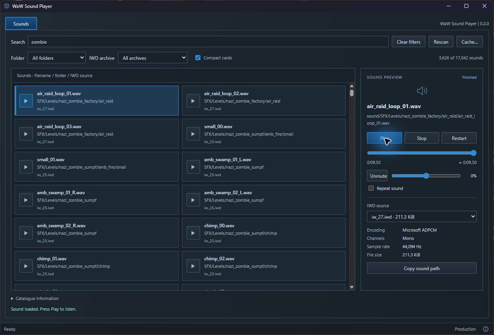

# WaW Sound Player

**An unofficial community app. Not affiliated with Treyarch, Activision or UGX.**

Browse and play World at War's IWD sounds, find a clip by ear and copy its sound path. Made by [phil81334](https://github.com/phil81334). Built with JavaScript, Rust, Vite, Tauri and Windows XAudio2.



## Download and run

1. Have the PC version of World at War installed on Windows 10 or 11. Modtools are not required.
2. Open [Releases](https://github.com/phil81334/waw-sound-player/releases/latest). Under **Assets**, download **waw-sound-player.exe**. The source-code ZIP is for development.
3. Put the EXE beside `CoDWaW.exe`, then double-click it.

You do not need Node.js, Rust or VS Code to use the EXE. Windows needs [WebView2](https://developer.microsoft.com/microsoft-edge/webview2/#download-section), usually already installed; if missing, install its **Evergreen Bootstrapper**. XAudio2 2.9 is included with Windows 10/11. The game does not need to be running.

## Browse sounds

Search filenames or folders, filter by folder or IWD archive, then select a row. Press its play button to listen immediately. **Play/Pause**, **Stop**, **Restart**, volume, mute and **Repeat sound** control one clip at a time. The timeline seeks within the clip; ADPCM positions follow compressed block boundaries. Compressed durations marked **≈** include codec padding.

**Compact cards** switches between the full-width list and a grid that fits more sounds across the window. Selection and playback stay in place when switching. Both layouts load only the visible items.

Sounds load only from `sound/*.wav` entries inside the IWD archives in `main`, including installed localized archives. PCM, Microsoft ADPCM and xWMA are identified from their headers. A `.wav` filename can contain xWMA audio. Multiple IWD sources for one path remain selectable; no game load-order behavior is implied.

**Copy sound path** copies the path relative to `sound/`, including `.wav`. This is a file path, not a script sound alias. Previews play individual clips; in-game aliases, volume/pitch settings, spatialization and reverb are not recreated. Loose files in `raw`, FastFiles, editing and exporting are outside v1. Game files are never changed.

The catalogue is cached in AppData. Audio loads on selection, with only one selected clip retained; no extracted sound files are saved. The preview limit is 128 MiB per clip. Unsupported or damaged audio shows a clear error when selected. **Catalogue information** shows counts and archive-read warnings. **Cache…** shows the location/size and clears the saved catalogue; **Rescan** reads the archive directories again. Scrolling only creates the visible rows.

## Run from source

**Windows setup — do this once.** Skip anything already installed.

| Install | What to choose |
| --- | --- |
| [VS Code](https://code.visualstudio.com/) | The Windows installer. This is where you open the project. |
| [Node.js](https://nodejs.org/en/download) | **LTS**, **Windows**, **Installer (.msi)**. Keep defaults; npm is included. |
| [Microsoft C++ Build Tools](https://visualstudio.microsoft.com/visual-cpp-build-tools/) | Select **Desktop development with C++**, including the MSVC tools and Windows SDK. These also compile the small native audio bridge. |
| [Rust](https://rust-lang.org/tools/install/) | Download and run **rustup-init.exe (x64)**. Choose the default installation. |

Close and reopen VS Code after installing these. [Tauri's Windows guide](https://v2.tauri.app/start/prerequisites/#windows) has more help. Vite and Tauri are installed by the project; no Python, FFmpeg, extraction helper or legacy DirectX SDK is needed.

1. Download **Code → Download ZIP**, then extract it. You can clone the repo instead if you already use Git.
2. In VS Code, choose **File → Open Folder** and open the extracted folder containing `package.json`.
3. Create a folder named `.local`, then a file inside it named `game-path.txt`.
4. Open your WaW folder in File Explorer—the one containing `CoDWaW.exe`. Copy the folder address into `game-path.txt`, one line with no quotes or EXE filename. Use your actual drive and folder.
5. Choose **Terminal → New Terminal** and run these one at a time:

   ```powershell
   npm install
   npm run dev
   ```

The first run downloads and compiles dependencies, so give it time. Keep the terminal open; press **Ctrl+C** to stop development. Next time, run `npm run dev`, or use the play button beside **dev** in VS Code's **NPM Scripts** panel. If hidden, right-click the Explorer panel headings and enable **NPM Scripts**.

| Command | What it does |
| --- | --- |
| `npm run dev` | Opens the desktop app for development. |
| `npm run dev:web` | Shows the UI in a browser. Cannot read or play game sounds. |
| `npm run build` | Creates `release/waw-sound-player.exe` and its versioned copy. |
| `npm run build:web` | Builds UI files only. No EXE. |

To make your own EXE, run `npm run build`, then copy `release/waw-sound-player.exe` beside `CoDWaW.exe`. The packaged app always uses its own folder.

[Credits](ATTRIBUTION.md) · [GPL-3.0 licence](LICENCE)
